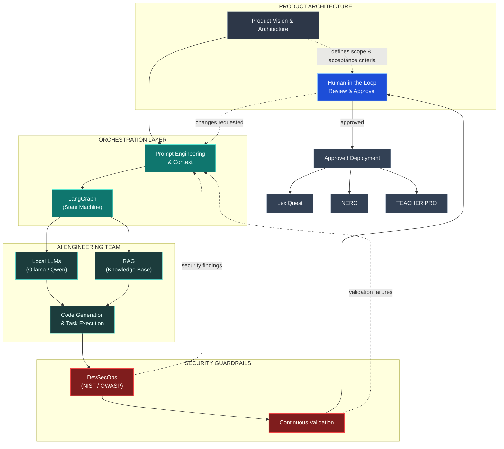

# Expedito

### AI Orchestrator | DevSecOps | Software Engineer

I translate product vision into secure software by combining product thinking, sound architecture, and AI-assisted engineering. I build practical, privacy-conscious systems and orchestrate AI agents to accelerate delivery while keeping technical decisions and quality accountable.

## Product Vision, Engineered

I shape product ideas into architectures, roadmaps, and clear engineering constraints. I then coordinate AI tools and agents through well-defined tasks, review their output, and integrate the results into cohesive software. This model combines the speed of AI-assisted development with human ownership of product direction, security, and quality.

*Orchestration Model: Human-led architecture and approval, AI-driven execution, and layered DevSecOps guardrails from vision to deployment.*

## Core Skills & Orchestration Stack

| Capability | How it works | Orchestration value |
| --- | --- | --- |
| **Agentic Workflows (LangGraph)** | Represents agent workflows as stateful graphs: nodes perform work, edges define transitions, and shared state carries context. | Provides the control flow for tool use, branching, and multi-step execution, enabling bounded autonomy with explicit checkpoints. |
| **Local LLMs & Privacy (Ollama, Qwen)** | Runs models locally using tools such as Ollama, including Qwen model families. | Keeps data processing under local control, can reduce inference costs depending on hardware and workload, and limits dependence on a single hosted provider. |
| **RAG (Retrieval-Augmented Generation)** | Retrieves relevant material from a selected knowledge base and supplies it to the model at query time. | Grounds responses in domain sources, makes results easier to verify, and helps mitigate unsupported generations. |
| **Prompt Engineering & Context Management** | Defines agent roles, task instructions, constraints, tools, and the information available at each step. | Functions as the management layer for AI agents: clear scope and context improve consistency, output quality, and reviewability. |
| **Full-Stack Engineering (Next.js, FastAPI, Python)** | Connects interfaces, APIs, data, and model capabilities into complete applications. | Provides the robust product environment where agents can support real workflows and AI capabilities become maintainable user experiences. |
| **DevSecOps & Security (NIST, OWASP)** | Applies secure design, threat modeling, testing, and recognized security guidance across the development lifecycle. | Integrates security early and supports systems that are more resilient, auditable, and aligned with relevant standards and requirements. |

## Featured Projects

- **LexiQuest (E.IA)** — An EdTech SaaS for spaced-repetition learning (SRS), built around a Next.js and Prisma architecture. AI orchestration supports product planning and coordinated implementation.
- **NERO** — A local-first autonomous agent for tax automation, using LangGraph to structure workflows and Ollama to run local models.
- **TEACHER.PRO** — A local English tutor combining Whisper, WavLM, and Qwen for speech transcription, phonetic analysis, and personalized practice.
- **Security Guides** — Technical documentation and threat-intelligence mapping across NIST guidance, STIGs, CVEs, and security protocols.

## Connect

- **GitHub:** [@eartnet09-boop](https://github.com/eartnet09-boop)

<!-- Add verified LinkedIn and professional email links here when available. -->
